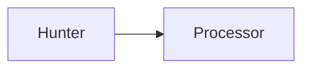

# Building and translating the manual

English Markdown in `src/` is the authoritative source. Translations live in
`po/de.po` (German) and `po/ca.po` (Catalan). Every edition shares chapter
filenames, examples, diagrams, and explicit heading IDs. Catalan is published
at the site root; English is published at `/en/` and German at `/de/`.
Generated HTML and translation templates are not committed.

## Tools

Install Python 3, GNU Gettext (`msginit`, `msgmerge`, `msgfmt`, `msgcat`, `msgattrib`), and a
current Rust toolchain. On Linux x86_64, install the pinned mdBook tools with:

```bash
bash docs/manual/tools/install.sh "$HOME/.local"
export PATH="$HOME/.local/bin:$PATH"
```

The installer pins mdBook, mdbook-mermaid, and mdbook-i18n-helpers in one place
for both local builds and CI. The translation helpers use a pinned Git revision
because released versions target mdBook 0.4, while this manual uses mdBook 0.5.
On other platforms, build the same versions with Cargo (see the installer for
version numbers and the exact translation-helper revision).

## Build and preview

Run these commands from the repository root:

```bash
make manual                # Build English and every configured translation
make manual-check          # Validate catalogs and report translation coverage
make manual-serve          # Build and serve the whole site on localhost:3000
make manual-serve MANUAL_PORT=3001
```

Open `http://localhost:3000/` for Catalan, `http://localhost:3000/en/` for English,
or `http://localhost:3000/de/` for German.
The language selector preserves the current chapter, heading fragment, and query
string. The preview server binds to localhost. Rebuild/restart it after edits;
it serves the assembled site rather than providing mdBook's single-edition live
reload. `make manual-clean` removes generated HTML.

GitHub Actions builds all configured editions into one Pages artifact. The CNAME
stays at the artifact root. Pull-request checks validate catalogs and build all
editions without publishing them.

The production domain is `lippy.cat`: Catalan is at `https://lippy.cat/`,
English at `https://lippy.cat/en/`, and German at `https://lippy.cat/de/`.
Before deploying the domain change, register the domain, verify ownership in
GitHub, and configure the repository's Pages custom domain and DNS records
following [GitHub's custom-domain documentation](https://docs.github.com/en/pages/configuring-a-custom-domain-for-your-github-pages-site/managing-a-custom-domain-for-your-github-pages-site).
Enable HTTPS once GitHub has provisioned the certificate.

The previous emoji domain, `🫦🐱.ws` (`xn--5o8hj1i.ws`), needs a separate
HTTPS-capable forwarding service with a permanent HTTP redirect to
`https://lippy.cat/en/`. DNS records alone cannot redirect to a language path.
For existing chapter links, preserve the old English chapter path under `/en/`
(for example, `/installation.html` redirects to `/en/installation.html`).
GitHub Pages hosts the manual; the forwarding service only handles requests for
the previous domain.

For the emoji domain at GoDaddy, open **Domain Settings → DNS → Forwarding**
and add forwarding to `https://lippy.cat/en` with **Permanent (301)** and
without masking. GoDaddy documents automatic HTTPS support for new forwarding
configurations in its [forwarding instructions](https://www.godaddy.com/help/forward-my-godaddy-domain-12123).
Set this up after the new Pages domain is serving successfully. Test existing
chapter URLs separately: the basic domain-forwarding documentation does not
guarantee the path mapping described above.

## Numbered figures

Wrap each Mermaid diagram in a semantic figure with a unique descriptive
`fig-...` anchor and a short caption. For example:

````markdown
<!-- i18n:skip -->

<figure id="fig-example-architecture">

<!-- i18n:skip -->



<figcaption>Capture agents send traffic to a central processor.</figcaption>

<!-- i18n:skip -->

</figure>
````

The skip comments keep wrappers and diagram code unchanged across languages;
translate the caption text while preserving its `<figcaption>` tags. Keep captions
on one source line. Do not type figure numbers into the source.

Screenshots can use the same wrapper with one Markdown image instead of a diagram:

```markdown
<!-- i18n:skip -->

<figure id="fig-packet-capture">


<figcaption>Live packet capture with the packet details pane enabled.</figcaption>

<!-- i18n:skip -->

</figure>
```

Give the image nonempty descriptive alt text, and translate it along with the
caption while preserving the image path. Keep the complete image on its own line.
Images are centered and shrink to fit the chapter width. Unnumbered images, such
as the introductory demo, can remain outside figure wrappers.

The figures preprocessor runs after Gettext and before Mermaid. It numbers figures
continuously in `SUMMARY.md` reading order, including nested chapters, and writes
localized labels (`Figure`, `Abbildung`, `Figura`) into the HTML. Individual
chapters and the print page share the same numbers, including without JavaScript.
Adding or reordering figures changes numbers; descriptive anchors remain stable.
For a numbered reference in prose, write `{{#figure fig-distributed-architecture}}`.
The preprocessor turns it into a localized link such as “Figure 3”, finding its
chapter automatically. Forward references and references across chapters are
supported; unknown identifiers and malformed markers fail the build. Translate
the surrounding prose while keeping the marker and identifier unchanged. Code
examples containing these markers remain literal.

The [List of Figures](src/appendices/list-of-figures.md) uses a standalone
`{{#figure-list}}` placeholder preceded by `<!-- i18n:skip -->`. It generates links
in reading order using the same localized captions and numbers; do not maintain
a second list of captions or numbers. Link labels and destinations are generated
at build time, including in the print edition and without JavaScript.

Every figure must contain exactly one Mermaid diagram or Markdown image and a
nonempty caption, placed after the diagram or image.
Missing wrappers, malformed markup, and duplicate anchors fail the build with
chapter context. When adding a language, add its figure label in `tools/figures.py`.
Caption text is searchable, and caption styling follows the current theme and
keeps figures together for printing when page space permits.
Figure labels and numbers use a nonbreaking space in references, captions, and
the appendix, including print output.

## Image viewer

Click or tap a chapter image or Mermaid diagram to open it in a fullscreen
viewer. Keyboard users can focus the image and press Enter or Space. Use the
zoom controls to enlarge details and scroll the image; Fit to screen restores
the initial view. Close the viewer with its close button or Escape. Focus
returns to the original image.

The viewer preserves animated GIFs and uses each edition's `imageViewer` labels
in `languages.json`. Diagrams are rendered independently inside the viewer so
their SVG identifiers do not collide with the chapter. Print output retains the
ordinary chapter images and captions.

## External links

External web links open in a new tab. Text links receive a decorative ↗ marker,
and their accessible labels announce the behavior using each edition's
`externalLinkLabel` in `languages.json`. Icon-only links keep their existing icon.
Internal chapter and section links retain normal navigation. The enhancement
also handles links added after the page loads and preserves existing `rel` values.

## Glossary hints

The assembled manual shows glossary definitions on hover or keyboard focus.
Click, tap, Enter, or Space keeps a definition open; activate the term again,
press Escape, or click elsewhere to dismiss it. The popup contains only the term
and its definition in the current edition's language, preserving the glossary's
links to related chapters and sections. Focus stays on the term; Tab reaches any
reference links before the next chapter control. Escape from a reference link
returns focus to the term. For an overflowing definition, use the
arrow keys, Page Up/Down, or Home/End while the term has focus to scroll its text.

Definitions have a single source: the glossary table in
`src/appendices/glossary.md` and its existing translated PO entries. Each term
cell has an inline marker with a stable identifier, for example:

```html
<span id="term-bpf" data-glossary-term="bpf">**BPF**</span>
```

Keep the identifiers and attributes identical in every translation. They provide
glossary fragment links and connect definitions to `term-hints.json`, which stores
matching policy without duplicating definitions. To add a term, add its glossary
row and a corresponding policy entry, then update and review every translation:

```json
"bpf": {
  "automatic": true,
  "caseSensitive": true,
  "aliases": {}
}
```

Automatic matching uses the translated label plus any aliases for that language.
Aliases can be configured as `"aliases": {"en": ["another name"]}`; supply other
language aliases where needed. Matching uses complete terms, longest aliases
first. Case-sensitive matching is appropriate for most abbreviations. Ambiguous
words such as filter, processor, and tap use `"automatic": false`; annotate a
particular occurrence when it needs an explanation:

```html
<span data-term="processor">processor</span>
```

Translate the visible word while retaining `data-term` and its identifier. Explicit
annotations are always eligible; every eligible automatic occurrence is enhanced,
so hints are available when readers follow links to chapter subsections. To
suppress automatic matching in a passage, use:

```html
<span data-no-term-hints>Text without automatic glossary hints.</span>
```

Existing links, headings, code, diagrams, form controls, and the glossary and print
pages are excluded. Put annotations in ordinary prose, outside these elements.
The build validates identifiers and cross-language annotation attributes. Missing
definitions, duplicate identifiers, and conflicting aliases fail the build with
context. No additional translated popup controls are required when adding an
edition.

`make manual` generates an edition-specific `term-hints.json` beside each edition's
HTML after mdBook renders it. Definitions include plain text and structured text/link
parts, with reference destinations resolved within the current edition. These
dictionaries and the book output are ignored.
Use `make manual-serve` to preview hints; a bare `mdbook build` does not run this
post-build step. JavaScript-disabled readers still have the complete glossary.

`make manual-check` runs Python regression checks, including dictionary validation.
After building all editions, run the separate browser suites with an installed
Playwright module and Chromium:

```bash
PLAYWRIGHT_MODULE=/path/to/node_modules/playwright \
  CHROMIUM_EXECUTABLE=/usr/bin/chromium \
  node docs/manual/tools/test_term_hints_browser.cjs
PLAYWRIGHT_MODULE=/path/to/node_modules/playwright \
  CHROMIUM_EXECUTABLE=/usr/bin/chromium \
  node docs/manual/tools/test_image_viewer_browser.cjs
```

The browser suites serve local fixtures and the generated manual, check mouse,
keyboard, touch, translations, exclusions, themes, and failure behavior, and close
their servers and browsers when finished. The image viewer suite also verifies
zoom, focus restoration, print behavior, and nonbreaking figure references.
Follow their output for screenshot artifacts and remove temporary QA files after
review.

## Updating translations

After editing the English source:

```bash
make manual-translations
```

This regenerates the ignored `po/messages.pot` template and merges it into each
catalog. Existing translations are retained; new entries are empty and changed
entries may be marked **fuzzy** (needing review). Use a PO editor or carefully
edit `msgstr` values. Do not edit `msgid` values: fix the English source instead.

Review changed entries against their English text, then remove the fuzzy marker.
Missing and fuzzy translations render in English. The build filters fuzzy entries
from temporary copies of the catalogs, including chapter titles; it never changes
the committed catalogs. CI reports coverage so English
changes can ship while translation updates follow separately. To require a fully
translated current manual, run:

```bash
python3 docs/manual/tools/manual.py check --require-complete
```

Catalog checks run regression tests for fuzzy fallback, validate Gettext syntax,
and preserve inline code and Markdown link targets. They do not replace a review
of technical meaning and language-specific wording.
Avoid unrelated catalog reformatting; `msgcat --sort-by-file` provides standard PO
formatting when needed. `make manual-extract` only regenerates the template.

## German conventions

Use formal **Sie**, **Ihnen**, and **Ihr** when addressing readers directly.
Prefer neutral phrasing when it reads naturally. Never mix formal and informal
address. For example: “Starten Sie den Prozessor mit folgendem Befehl.”

Use clear technical German and retain established acronyms such as CLI, TUI,
PCAP, TLS, SIP, and RTP. Keep these terms consistent:

| English                  | German                                                                            |
| ------------------------ | --------------------------------------------------------------------------------- |
| packet capture (process) | Paketerfassung                                                                    |
| capture (result)         | Paketmitschnitt / Mitschnitt                                                      |
| capture file             | Mitschnittdatei / PCAP-Datei                                                      |
| packet                   | Paket                                                                             |
| processor                | Prozessor                                                                         |
| hunter node              | Hunter-Knoten                                                                     |
| tap node                 | Tap-Knoten                                                                        |
| network interface        | Netzwerkschnittstelle                                                             |
| network segment          | Netzwerksegment                                                                   |
| protocol analysis        | Protokollanalyse                                                                  |
| LI delivery              | Ausleitung                                                                        |
| data/event delivery      | Übermittlung                                                                      |
| lawful interception      | rechtmäßige Telekommunikationsüberwachung (englisch Lawful Interception, kurz LI) |

Distinguish the process from its result: use **Paketerfassung** or **Pakete
erfassen** for the activity, and **Paketmitschnitt**, **Mitschnitt**, or
**Mitschnittdatei** for captured data and saved files. For example, “Starten Sie
die Paketerfassung”, but “Öffnen Sie den gespeicherten Mitschnitt”. Avoid
“gespeicherte Erfassungen” and “Erfassungsdateien”. In an already clear context,
“Erfassung” is sufficient for the process.

Use **Tab** and **Tabs**, not “Registerkarte” or “Registerkarten”. The TUI is
English-only: retain its visible tab names (**Capture**, **Nodes**,
**Statistics**, **Settings**, and **Help**), including the mode-specific labels
**Live Capture**, **Offline Capture**, and **Remote Capture**, and the short
label **Stats**. Write natural German compounds such as “Capture-Tab” and
“Nodes-Tab”. Preserve names of sub-views such as **Overview** and **Distributed**
when referring to their UI labels.

Translate **operational** according to the technical context. For the section
covering setup, certificate rotation, and logging, translate **Operational
Considerations** as **Hinweise zu Einrichtung und Wartung**.

At first mention in a translated chapter, include **Lawful Interception** alongside
the translated term and **LI**, so the origin of the abbreviation is clear. Later
mentions can use the translated term or **LI**.

For lawful interception, translate **delivery** as **Ausleitung** (for example,
“X2-IRI-Ausleitung” and “X3-CC-Ausleitung”). Use **Übermittlung** for general
data/event transport and when describing the transmission itself. Avoid
“Auslieferung” in the LI context. Keep technical identifiers such as
`--li-delivery-*` and `delivery_type` unchanged. The Bundesnetzagentur uses
“Ausleitung” for interception copies and IRI data in its
[TR TKÜV terminology](https://www.bundesnetzagentur.de/DE/Allgemeines/Presse/Amtsblatt/Einzeldownloads/Amtsblatt_26_5.pdf?__blob=publicationFile&v=3).

Translate prose, headings, chapter titles, and descriptive table cells. Preserve
command names, flags, configuration keys, environment variables, paths, protocol
identifiers, and link destinations. Fenced blocks use `<!-- i18n:skip -->` so
commands, configuration examples, expected output, and Mermaid diagrams remain
identical across languages. Explain examples in the surrounding translated prose.

Retain explicit `{#heading-id}` attributes when renaming headings. For a new
heading, choose an explicit stable ID before translating it. These IDs preserve
existing English fragment URLs and cross-language navigation.

## Catalan conventions

Use standard Catalan and address readers consistently with **vós**: **executeu**,
**feu**, **podeu**, and **vostre**. Prefer neutral phrasing when natural. Retain
established acronyms such as CLI, TUI, PCAP, TLS, SIP, and RTP.

| English                  | Catalan                            |
| ------------------------ | ---------------------------------- |
| packet capture (process) | captura de paquets                 |
| capture (result)         | captura                            |
| capture file             | fitxer de captura / fitxer PCAP    |
| packet                   | paquet                             |
| processor                | processador                        |
| hunter node              | node Hunter                        |
| tap node                 | node Tap                           |
| network interface        | interfície de xarxa                |
| network segment          | segment de xarxa                   |
| protocol analysis        | anàlisi de protocols               |
| LI delivery              | lliurament LI / lliurament X2/X3   |
| data/event delivery      | transmissió de dades/esdeveniments |
| lawful interception      | intercepció legal (LI)             |
| sanitized identifier     | identificador depurat              |

Distinguish sanitization from anonymization: **depurat** does not promise that an
identifier is anonymous. Translate **anonymized** as **anonimitzat** only when the
source makes that claim. Preserve authorization requirements, negation, expiry,
resource limits, and delivery guarantees exactly; consult the English source and
German translation when resolving technical intent.

The TUI remains English-only. Retain visible labels such as **Capture**, **Nodes**,
**Statistics**, **Settings**, **Help**, **Live Capture**, **Offline Capture**,
**Remote Capture**, **Stats**, **Overview**, and **Distributed**. Translate the
surrounding explanation, for example, “la pestanya Capture”. Translate descriptive
link labels, but preserve their destinations. The shared rules above for inline
code, command examples, configuration keys, and stable heading IDs also apply to
Catalan.

## Adding another language

- [ ] Add an entry to `languages.json` with its code, native name, `<code>/` path,
      translated title, and description. Keep the root edition first with an empty
      path; all other editions use `<code>/`. English remains the source language.
- [ ] Run `make manual-translations` to initialize `po/<code>.po`.
- [ ] Translate the catalog and document any language-specific style conventions.
- [ ] Run `make manual-check manual` and preview navigation, search, and diagrams.

The build, deployment, and language selector discover editions from this manifest;
there is no separate workflow or source tree to maintain for each language.
