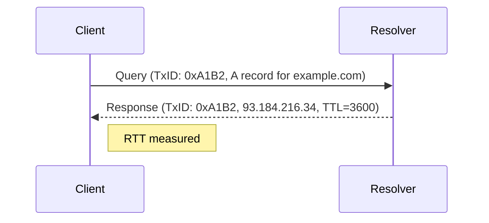

# DNS Analysis {#dns-analysis}

The DNS analyzer correlates queries with their responses and measures resolution latency.

## Query/Response Correlation {#queryresponse-correlation}

lippycat matches DNS queries to their responses using the transaction ID (a 16-bit identifier in the DNS header), as shown in {{#figure fig-dns-query-response}}. When a response is correlated, the `QueryResponseTimeMs` field shows the round-trip time in milliseconds.

<!-- i18n:skip -->

<figure id="fig-dns-query-response">

<!-- i18n:skip -->



<figcaption>DNS query and response correlation.</figcaption>

<!-- i18n:skip -->

</figure>

Start DNS capture:

<!-- i18n:skip -->

```bash
sudo lc sniff dns -i eth0
```

Filter by domain:

For an exact domain:

<!-- i18n:skip -->

```bash
sudo lc sniff dns -i eth0 --domain example.com
```

For wildcard matching:

<!-- i18n:skip -->

```bash
sudo lc sniff dns -i eth0 --domain "*.example.com"
```

Load domain patterns from a file for bulk monitoring:

<!-- i18n:skip -->

```bash
sudo lc sniff dns -i eth0 --domains-file watchlist.txt
```

## DNS Metadata Fields {#dns-metadata-fields}

Each DNS packet includes structured metadata:

| Field           | Description                         | JSON Path                      |
| --------------- | ----------------------------------- | ------------------------------ |
| Transaction ID  | Query/response correlator           | `.DNSData.TransactionID`       |
| Query Name      | Domain being queried                | `.DNSData.QueryName`           |
| Query Type      | Record type (A, AAAA, MX, etc.)     | `.DNSData.QueryType`           |
| Response Code   | NOERROR, NXDOMAIN, SERVFAIL, etc.   | `.DNSData.ResponseCode`        |
| Answers         | Array of answer records             | `.DNSData.Answers[]`           |
| RTT             | Query-to-response latency (ms)      | `.DNSData.QueryResponseTimeMs` |
| Tunneling Score | DNS tunneling probability (0.0-1.0) | `.DNSData.TunnelingScore`      |

## Common DNS Investigations {#common-dns-investigations}

**Find slow DNS resolutions:**

<!-- i18n:skip -->

```bash
sudo lc sniff dns -i eth0 2>/dev/null | \
  jq -r 'select(.DNSData.IsResponse and .DNSData.QueryResponseTimeMs > 100) |
    [.Timestamp, .DNSData.QueryName, (.DNSData.QueryResponseTimeMs|tostring) + "ms"] |
    @tsv'
```

**Monitor NXDOMAIN responses (non-existent domains):**

<!-- i18n:skip -->

```bash
sudo lc sniff dns -i eth0 2>/dev/null | \
  jq -r 'select(.DNSData.ResponseCode == "NXDOMAIN") |
    [.Timestamp, .SrcIP, .DNSData.QueryName] | @tsv'
```

**Track specific record types:**

For MX record lookups (email server discovery):

<!-- i18n:skip -->

```bash
sudo lc sniff dns -i eth0 2>/dev/null | \
  jq -r 'select(.DNSData.QueryType == "MX") |
    [.Timestamp, .DNSData.QueryName, (.DNSData.Answers[]?.Data // "pending")] |
    @tsv'
```

For TXT records, which are often used for SPF, DKIM, and domain verification:

<!-- i18n:skip -->

```bash
sudo lc sniff dns -i eth0 2>/dev/null | \
  jq 'select(.DNSData.QueryType == "TXT")'
```

## DNS Tunneling Detection {#dns-tunneling-detection}

lippycat includes entropy-based DNS tunneling detection. Tunneling encodes data in DNS queries, producing domain names with unusually high entropy (randomness). The analyzer scores each query from 0.0 (normal) to 1.0 (highly suspicious):

To flag potential DNS tunneling:

<!-- i18n:skip -->

```bash
sudo lc sniff dns -i eth0 --detect-tunneling 2>/dev/null | \
  jq -r 'select(.DNSData.TunnelingScore > 0.7) |
    [.Timestamp, .SrcIP, .DNSData.QueryName,
     "score=" + (.DNSData.TunnelingScore|tostring)] | @tsv'
```

High-entropy queries (long, random-looking subdomains) combined with high query volume to a single domain are strong indicators of DNS tunneling or data exfiltration.

## Structured DNS security notices {#structured-dns-security-notices}

`--dns-notices` enables typed DNS tunneling findings independently of command hooks. It is off by default for generic capture; DNS subcommands retain their `--detect-tunneling` option, enabled by default. A configured `--tunneling-command` retains the legacy default detector policy. `--dns-notice-threshold` (default `0.7`) and `--dns-notice-debounce` (default `5m`) control the shared decision policy; existing processor/tap threshold and debounce options remain aliases.

Enable a notice log without running an external command:

<!-- i18n:skip -->

```bash
sudo lc tap dns -i eth0 --insecure --dns-notices \
  --log-dir ./logs --log-streams notice --log-format json
```

Each `dns.tunneling` notice has schema version `1`, category `security`, severity `warning`, and status `triggered`. It records the domain, heuristic score, threshold, entropy, retained unique subdomains and source addresses, and a reference to the triggering flow. `queries` preserves the legacy count of DNS observations, including responses. The score is evidence for investigation, not proof of tunneling. A domain finding can aggregate several observations; its bounded evidence references are not a complete packet inventory. Truncation flags identify retained lower bounds.

Detector state and debounce use capture timestamps, making offline findings reproducible. `--dns-analysis-ports` selects eligible ports. `--dns-notice-max-domains` bounds tracked domains globally across capture scopes; `--dns-notice-max-subdomains` and `--dns-notice-max-source-ips` bound evidence per domain; `--dns-notice-retention` expires state by capture time. Hunters, capture epochs, interfaces, and offline inputs have separate observation scopes. Overlapping private addresses do not combine their findings.

Packet forwarding delegates findings to the upstream analysis authority. A packet-forwarding hop rejects event-only children; the child must explicitly permit packet fallback or use an event-forwarding route. Event forwarding produces findings at the edge; receiving or relaying a notice does not rescore DNS or execute a command. TUI Events show notices in All and DNS scopes. Filters include `kind:notice`, `detector:dns.tunneling`, `score:>=0.7`, and `domain:example.test`. Subscriber policy removes cross-flow source-address lists and references unless sensitive fields are authorized, setting `evidence_redacted=true` independently of capacity truncation.

`process` and `tap` command hooks accept only fresh local detector findings. Notice transport retries, received-notice recovery, and event ingress WAL replay do not execute them. Explicit local PCAP reanalysis can create a fresh finding and run a configured command; `sniff` and offline `watch` do not own a command worker. Existing substitutions are preserved. Actions have a bounded queue of `128`, a process-lifetime identity limit of `65536`, and an output limit of `64 KiB`; exhaustion and failures are reported separately from notices. Async command success, file-log durability, and best-effort TUI delivery are distinct outcomes. Exactly-once external actions across crashes are not promised.

`lc show status` includes `dns_notices` when the notice policy is configured; `enabled` identifies local canonical detection. Counters separate emitted, suppressed, and dropped findings and dropped actions from command completion, failure, duplicates, queue depth, and process-lifetime identity accounting. `log_dropped`, `log_errors`, `dispatcher_sink_dropped`, and `dispatcher_sink_errors` are shared sink totals across all streams. A relay can receive notices while its local detector is disabled.
