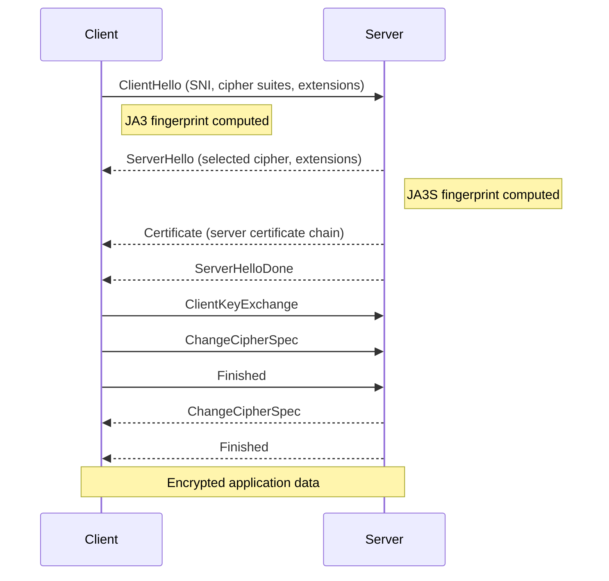

# TLS Inspection {#tls-inspection}

The TLS analyzer inspects handshake messages without decrypting traffic. It extracts connection metadata from ClientHello and ServerHello messages, including SNI, cipher suites, and TLS fingerprints.

## TLS Handshake Analysis {#tls-handshake-analysis}

<!-- i18n:skip -->

<figure id="fig-tls-handshake">

<!-- i18n:skip -->



<figcaption>TLS handshake analysis and fingerprinting.</figcaption>

<!-- i18n:skip -->

</figure>

lippycat captures and parses the unencrypted handshake messages at the start of every TLS connection, as illustrated in {{#figure fig-tls-handshake}}.

Start TLS capture:

<!-- i18n:skip -->

```bash
sudo lc sniff tls -i eth0
```

Filter by Server Name Indication (SNI):

For a specific domain:

<!-- i18n:skip -->

```bash
sudo lc sniff tls -i eth0 --sni example.com
```

For a wildcard:

<!-- i18n:skip -->

```bash
sudo lc sniff tls -i eth0 --sni "*.example.com"
```

For bulk filtering from a file:

<!-- i18n:skip -->

```bash
sudo lc sniff tls -i eth0 --sni-file domains.txt
```

## ECH offer visibility {#ech-offer-visibility}

lippycat reports the presence of the `encrypted_client_hello` extension (65037) in a completely framed outer ClientHello. This includes GREASE offers. It does not prove server acceptance, reveal the encrypted inner ClientHello, or identify an application. See [RFC 9849](https://www.rfc-editor.org/rfc/rfc9849.html).

The TLS capture summary reports `ECH offered / ClientHello`. The counting unit is a complete ClientHello accepted by the shared analysis runtime, before display-content filters. TCP segmentation and TLS-record fragmentation are reassembled; TCP retransmissions are counted once. Distinct ClientHellos on the same connection, including retries after HelloRetryRequest, count separately. Capture beginning midstream can contribute when a complete ClientHello is recovered; missing or malformed framing contributes no denominator. These are observation counts, not unique connections.

Packet metadata uses `ClientHelloObserved` to qualify `ECHOffered`: false observation availability means unknown, not an observed absence. ServerHello-only captures and older peers without these fields remain unknown. Typed TLS events and `ssl.log` carry `client_hello_count` and `ech_offered_count`; `ech_offered` is unset when no complete ClientHello evidence is available. Log coalescing preserves the counts. Packet-mode processors count at the processor; event-mode hunters count at the hunter. Relaying, transport retries, and subscriber fan-out do not create capture observations.

In the TUI, the HTTPS/TLS Statistics card reports the fraction over retained canonical TLS events and labels rows without ClientHello evidence separately. This window can be incomplete after retention eviction or event delivery loss. Packet and event details preserve unknown values; Events filters such as `ech_offered:true`, `ech_offered:false`, and `client_hello_count:>=1` only match available evidence. Durable logs can also omit observations after queue overflow or I/O failure; do not interpret a missing row as an observed negative.

## JA3 and JA3S Fingerprinting {#ja3-and-ja3s-fingerprinting}

JA3 creates a fingerprint of a TLS client by hashing the following fields from the ClientHello message:

<!-- i18n:skip -->

```
TLS Version | Cipher Suites | Extensions | Elliptic Curves | EC Point Formats
```

These fields are concatenated and MD5-hashed to produce a 32-character fingerprint. Because different applications construct their ClientHello differently (different cipher suite orderings, different extensions), the JA3 fingerprint identifies the client software regardless of IP address.

JA3S applies the same concept to the ServerHello, fingerprinting the server's response (TLS version, selected cipher suite, extensions).

lippycat computes both automatically:

| Field            | Description                  | JSON Path                  |
| ---------------- | ---------------------------- | -------------------------- |
| JA3 String       | Raw fingerprint input        | `.TLSData.JA3String`       |
| JA3 Fingerprint  | MD5 hash                     | `.TLSData.JA3Fingerprint`  |
| JA3S String      | Raw server fingerprint input | `.TLSData.JA3SString`      |
| JA3S Fingerprint | MD5 hash                     | `.TLSData.JA3SFingerprint` |
| JA4 Fingerprint  | Modern fingerprint format    | `.TLSData.JA4Fingerprint`  |

> **JA4 compatibility note:** Builds containing the standards-correctness fix
> use SHA-256 (truncated to 12 hexadecimal characters) and the first/last ALPN
> character transformation required by JA4. Fingerprints produced by older
> lippycat builds used a non-standard truncated MD5 value and may also encode
> ALPN differently. Replace stored JA4 fingerprints and `tls_ja4` filters with
> values generated by a conforming JA4 implementation. lippycat does not
> silently match both formats. A runtime compatibility warning is not emitted
> because legacy and standard values have the same syntax and cannot be
> distinguished reliably.

**Filter by known fingerprint:**

To capture traffic matching a known malware JA3 fingerprint:

<!-- i18n:skip -->

```bash
sudo lc sniff tls -i eth0 --ja3 "e7d705a3286e19ea42f587b344ee6865"
```

To load multiple fingerprints from a threat intelligence file:

<!-- i18n:skip -->

```bash
sudo lc sniff tls -i eth0 --ja3-file known-bad-ja3.txt
```

**Build a fingerprint inventory:**

To list unique JA3 fingerprints with SNI:

<!-- i18n:skip -->

```bash
sudo lc sniff tls -i eth0 2>/dev/null | \
  jq -r 'select(.TLSData.HandshakeType == "ClientHello") |
    [.SrcIP, .TLSData.SNI, .TLSData.JA3Fingerprint] | @tsv' | \
  sort -u
```

## TLS Metadata Fields {#tls-metadata-fields}

| Field           | Description                                | JSON Path                  |
| --------------- | ------------------------------------------ | -------------------------- |
| Handshake Type  | ClientHello, ServerHello, Certificate      | `.TLSData.HandshakeType`   |
| TLS Version     | Negotiated version (e.g., "TLS 1.3")       | `.TLSData.Version`         |
| SNI             | Server Name Indication                     | `.TLSData.SNI`             |
| Cipher Suites   | Offered cipher suites (ClientHello)        | `.TLSData.CipherSuites`    |
| Selected Cipher | Chosen cipher suite (ServerHello)          | `.TLSData.SelectedCipher`  |
| ALPN Protocols  | Application protocols (e.g., h2, http/1.1) | `.TLSData.ALPNProtocols`   |
| Handshake Time  | ClientHello to ServerHello latency (ms)    | `.TLSData.HandshakeTimeMs` |
| Risk Score      | Security risk assessment (0.0-1.0)         | `.TLSData.RiskScore`       |

## Common TLS Investigations {#common-tls-investigations}

**Detect weak TLS versions:**

<!-- i18n:skip -->

```bash
sudo lc sniff tls -i eth0 2>/dev/null | \
  jq -r 'select(.TLSData.Version == "TLS 1.0" or .TLSData.Version == "TLS 1.1") |
    [.Timestamp, .SrcIP, .DstIP, .TLSData.SNI, .TLSData.Version] | @tsv'
```

**Correlate ClientHello with ServerHello:**

lippycat correlates handshake pairs when `--track-connections` is enabled (the default). Correlated pairs include the handshake latency:

<!-- i18n:skip -->

```bash
sudo lc sniff tls -i eth0 2>/dev/null | \
  jq -r 'select(.TLSData.CorrelatedPeer) |
    [.Timestamp, .TLSData.SNI, (.TLSData.HandshakeTimeMs|tostring) + "ms"] |
    @tsv'
```

**High-risk connections:**

<!-- i18n:skip -->

```bash
sudo lc sniff tls -i eth0 2>/dev/null | \
  jq -r 'select(.TLSData.RiskScore > 0.5) |
    [.Timestamp, .SrcIP, .TLSData.SNI, .TLSData.Version,
     "risk=" + (.TLSData.RiskScore|tostring)] | @tsv'
```
