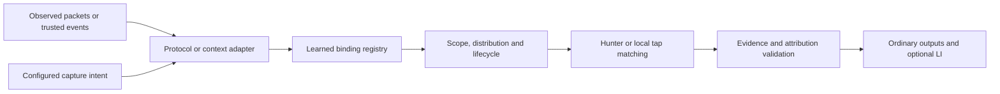

# Generalized dynamically learned capture rules

Date: 2026-10-19

Status: research and architectural proposal. Distributed VoIP media selection is
implemented; the general framework described here is proposed work.

Implementation baseline: `69c89acc`.

## Purpose

Generalize the existing distributed media-selection machinery so that different
kinds of evidence can enable temporary, scoped packet capture. Keep VoIP working
through the same mechanism, with its current ownership and authorization checks,
while allowing future adapters for subscriber sessions, negotiated connections,
changing service endpoints, and diagnostic requests.

The common pattern is:

> An observation establishes a temporary relationship, and that relationship
> enables capture at appropriate sources.

For VoIP, selected SIP and SDP establish a relationship between a call and its
media endpoints. Other adapters could establish relationships between a device
and an assigned address, a service and its current endpoints, or an investigation
and a particular flow. The distribution machinery should not need to understand
each protocol's rules for establishing those relationships.

This is a general capture feature. Ordinary PCAP, analysis, forwarding, TUI, and
virtual-interface consumers must remain usable without LI. LI integrations must
retain their additional task, capture-authority, and delivery checks.

## Current implementation and extraction boundary

The existing implementation already provides much of the required control path:

| Implemented capability | Current location |
| --- | --- |
| Central SIP selection and media publication | [processor media control](../../internal/pkg/processor/media_control.go) and [call selection](../../internal/pkg/callselection/tracker.go) |
| Temporary rules, issuer generations, revisions, expiry, and bounded state | [media-rule store](../../internal/pkg/mediarules/store.go) |
| Scoped snapshots, updates, and installation reporting | [media control protocol](../../api/proto/media.proto) and [wire service](../../internal/pkg/mediarules/wire/service.go) |
| Hunter matching and effective application status | [hunter media rules](../../internal/pkg/hunter/media_rules.go) |
| Local tap behavior without loopback transport | [distributed media guide](../DISTRIBUTED_MEDIA.md#standalone-tap) |
| Exact signed media proof for protected capture | [capture grants](../../internal/pkg/capturegrant) |
| Historical packet custody and replay boundaries | [reliable raw packets](../PROCESSOR_FAILOVER.md#reliable-raw-packet-setup) |

The reusable behavior is mixed with VoIP-specific data. A
[`mediarules.Rule`](../../internal/pkg/mediarules/types.go) requires a
`CallAssociation`, SIP dialog details, and endpoints classified as RTP, RTCP, or
multiplexed media. Hunter startup requires VoIP mode, and its resolver parses UDP
media before producing a call association. The admission owner identity also
contains a Call-ID.

Generalization therefore needs a separation of responsibilities across the data
model, matching path, wire contract, and producer/consumer integration. Renaming
packages alone would leave the same protocol dependency in place.

## Potential applications

The following are candidate uses of the proposed framework. Except for existing
VoIP media selection, they do not describe implemented learned-rule adapters.

| Context | Evidence interpreted by an adapter | Derived capture selection | Important distinction |
| --- | --- | --- | --- |
| VoIP | Selected SIP dialog and validated SDP | Associated RTP/RTCP endpoints | A media endpoint hit is not sufficient to assign an ambiguous call. |
| Streaming | RTSP session and transport negotiation | Associated stream endpoints | Session negotiation and transport variants belong to the RTSP adapter. |
| File transfer | FTP control exchange and negotiated data connection | Temporary data endpoint or flow | Control and data observations can occur at different capture points. |
| Subscriber monitoring | Established RADIUS session/address evidence | Subscriber addresses or prefixes | An address mentioned in a message does not establish ownership. |
| Device troubleshooting | Confirmed DHCP lease evidence | Traffic involving the assigned address | Requested addresses, renewed leases, and address reuse need distinct handling. |
| Service troubleshooting | Trusted service or workload membership changes | Current service endpoint set | Membership establishes relevance; it need not prove one application owns every packet. |
| Incident investigation | Authorized alert or diagnostic request | Bounded host, endpoint, or flow capture | The request supplies capture intent; an alert does not independently grant permission. |
| Name-based troubleshooting | DNS answers associated with a selected query or name | Candidate traffic to resolved addresses | A resolved address does not establish exclusive hostname attribution. |

RTSP transport negotiation, FTP data connections, and DHCP lease lifetimes are
described in [RFC 7826](https://www.rfc-editor.org/rfc/rfc7826.html),
[RFC 959](https://www.rfc-editor.org/rfc/rfc959.html), and
[RFC 2131](https://www.rfc-editor.org/rfc/rfc2131.html), respectively. How those
observations should authorize lippycat capture remains adapter-specific design
work.

## Separate evidence, capture intent, and attribution

The framework should distinguish three decisions:

| Decision | Meaning |
| --- | --- |
| Capture selection | A current rule selects this packet within an allowed capture intent and scope. |
| Subject attribution | An adapter can associate the packet with a particular call, session, workload, or investigation. |
| Output admission | A particular consumer is permitted to consume that packet and any asserted attribution. |

These decisions need not have the same answer. A DNS-derived address selector
might be useful for troubleshooting without proving that a packet belongs to the
queried hostname. An independently configured ordinary filter can select a
packet even when a learned relationship has become ambiguous. A captured packet
can be ineligible for an LI output after task revocation.

One packet can legitimately relate to several subjects: for example, a call, a
subscriber session, and an explicit diagnostic request. Uniqueness is evaluated
within the relevant adapter's attribution context. It is not a global requirement
that every packet have exactly one subject.

The core must not infer definitive attribution from selector priority, insertion
order, or the union of all matching bindings. Adapters provide the rules for
resolving, qualifying, or rejecting their own associations.

## Proposed architecture

Use one authoritative processor and explicitly scoped capture sources as the
initial generalization boundary. Preserve the working local tap path. Existing
transport failover does not imply replicated learned-binding authority between
independent processors.

### Protocol and context adapters

An adapter interprets evidence and maintains any state needed to establish a
relationship. It proposes binding creation, replacement, renewal, or withdrawal
under a configured capture intent. The framework checks that proposal against
the intent's allowed selector types, capture scopes, validity, and resource
limits before publication.

Adapters also validate subject attribution from returned packets and evidence.
The hunter-side qualifier and processor-side attribution validator can have
different responsibilities; a hunter may identify candidates that require more
context at the authority.

An adapter is a typed integration boundary, not necessarily a dynamically loaded
plugin. The first adapter should be the existing VoIP implementation. Future
adapters should not require SIP packages, a fake Call-ID, or an LI task to use the
shared engine.

### Shared learned-rule engine

The shared engine owns the mechanics that do not depend on protocol meaning:

- Bounded binding storage and resource accounting.
- Issuing authority, epochs, revisions, and stale-update rejection.
- Source/domain placement and required matching capabilities.
- Atomic replacement, snapshot synchronization, and withdrawals.
- Finite validity and expiry independent of transport contact.
- Per-source effective installation reports and errors.
- Matcher projection and shared physical-entry ownership.
- Transport of binding references and capture evidence.
- Status, reconciliation, and explicit recovery behavior.

It must not decide whether a SIP transaction is valid, a subscriber owns an
address, or a DNS answer proves application identity. Those are adapter decisions.

## Logical bindings and physical rules

A **binding** is a logical, evidence-backed relationship. A **selector** describes
packet properties to match. A **physical matching entry** is an installed backend
representation of one or more selectors.

Keep those identities separate. One binding can require several selectors on
several hunters. Several bindings can share one physical endpoint entry. Removing
one binding must not remove an entry still needed by another valid binding.
Sharing that entry must not merge the subjects or their authorization.

The proposed common binding envelope is:

| Field | Responsibility |
| --- | --- |
| Binding ID | Stable identity of this logical relationship. |
| Authority and epoch | Identify the issuing authority instance and prevent stale writers from restoring old state. |
| Binding revision | Identify the current relationship definition. Publication/snapshot ordering may retain a separate stream revision. |
| Adapter kind and contract version | Identify the typed interpretation and validation requirements. |
| Subject reference and incarnation | Identify the relevant subject lifetime without embedding SIP or subscriber fields in the core. |
| Capture-intent references and revisions | Preserve which current configured selections or protected grants justify the binding. |
| Source and network scope | Limit eligible sources, interfaces, and observation domains. |
| Typed selectors and qualifiers | State the required packet match semantics and consumer capabilities. |
| Evidence references | Link the relationship to its supporting observations. |
| Effective and expiry times | Bound when the installed relationship can select traffic. |
| Typed adapter context | Retain information needed for adapter-specific matching or attribution. |

These are conceptual fields, not a finalized protobuf schema. Keep adapter
context versioned and bounded; avoid an unrestricted map or unvalidated opaque
payload that can change selector meaning. The core can treat a subject reference
as opaque while still checking its envelope, adapter identity, size, and lifetime.

A subject incarnation is independent of an authority epoch. Recreating a workload,
reusing a SIP Call-ID, or reassigning an address must create a new relationship
lifetime even if the processor has not restarted.

## Selector model and matching capabilities

Use a small typed vocabulary with precise semantics:

| Selector family | Required semantics |
| --- | --- |
| IP address or prefix | Address family, prefix, and source/destination/either direction. |
| Transport endpoint | IP protocol, address, port, and endpoint direction. |
| Flow tuple | Explicit endpoint pair, IP protocol, and unidirectional or bidirectional interpretation. |
| Packet qualifier | A registered, versioned check such as the existing RTP/RTCP qualification. |

Specify composition explicitly: the fields within a selector constrain the same
candidate; alternative selectors form a union. Attach qualifiers to the relevant
selector or typed selector group so an OR branch cannot accidentally bypass a
required protocol check. Absence of a constraint must be explicit rather than
encoded as an accidental wildcard such as port zero.

The first extraction only needs the selector forms necessary to preserve current
VoIP behavior. Add prefix and other matching forms when a concrete adapter needs
them. Their semantics should fit the model without forcing immediate backend or
protocol implementation.

A source must support the complete required match contract. Unsupported rules
are rejected or reported as unsupported, never broadened silently. A core rule
that cannot be represented in eBPF may use an explicitly supported userspace
path, but the effective capture path must still admit its candidates. An earlier
static BPF rejection cannot be repaired by a later userspace match.

Backend projections can be broader candidate filters where userspace performs
the required exact checks. Reports must distinguish desired state, candidate
installation, and effective complete matching. A candidate-map update alone is
not proof that the whole rule is active.

## Scope, topology, and address views

Retain explicit mappings between source-local observation domains and the
authority's address realms. Network connectivity to a processor does not imply
that a hunter observes the correct traffic or uses the same address view.

The general engine should support explicit placement and capabilities; it should
not invent NAT translations or move selectors between unrelated networks that
reuse addresses. Where evidence and capture use different addresses, an adapter
needs a validated mapping or must leave the relationship unresolved.

Eligibility and authorization remain separate. A source can have the correct
interface/domain and matching capability while still being excluded by the
capture intent or protected grant.

## Observation ingestion and lifecycle

Preserve central learning from forwarded packets as the initial VoIP path.
Trusted typed observations or external control events are future ingestion
options, not prerequisites for extracting the shared engine. Any such input needs
explicit source trust, scope, stable event identity, ordering, and replay rules.
If two ingestion paths describe the same evidence, they must not create duplicate
relationship lifetimes.

An adapter owns the semantic events that create or end a relationship. The common
engine enforces the published bounds. Replacements that affect ownership or
authorization must become effective atomically; failed installation must not be
reported as synchronized.

Renewal requires current authoritative adapter state and current capture intent.
Adapters can define whether fresh activity is relevant to liveness, but receipt
of an already selected or replayed packet must not independently recreate expired
authority or bypass a withdrawn selection. Distinguish fresh control evidence,
data activity, retransmission, and historical replay.

Expiry must work without a successful withdrawal message. Reconnection reconciles
an authoritative snapshot and later updates; it does not extend old deadlines.
Restart must not restore stale attribution merely because an identifier or
address is reused. Any persisted learned state needs explicit revalidation and
must preserve epoch, incarnation, revision, and authorization boundaries.

Continuing capture while disconnected is an explicit policy bounded by applicable
validity and clock uncertainty. Sources cannot renew their own authority. Data
retention is separate: a long spool retention period does not grant a long
capture lifetime.

## Packet evidence and output integration

A captured candidate needs enough evidence for validation: actual capture source,
interface/domain, capture time, authority epoch, binding identity/revision, and
the applicable capture-intent lineage. Protected modes additionally retain the
exact signed authority required for historical verification.

The processor validates capture evidence and adapter-specific attribution before
subject-dependent operations. Do not attach all associated filter IDs to a packet
merely because a shared physical selector matched. Bound the number of returned
binding candidates, and define an explicit exhaustion outcome rather than
silently dropping candidates and treating the remainder as uniquely attributed.

Different outputs may require different levels of attribution. Ordinary capture
selected independently of a subject can follow its own policy. Per-call or
per-subscriber outputs must wait for the corresponding validated relationship.
Preserve original packet bytes and source metadata across PCAP, forwarding, TUI,
virtual-interface, and analysis paths.

Historical delivery validates the authority applicable at capture time and the
current rules for the intended output. Replaying stored evidence must not rearm
current capture. A transport custody receipt remains distinct from successful
analysis or downstream delivery; generalization must preserve that distinction.

## VoIP as the first adapter

Keep SIP transaction/dialog validation, SDP interpretation, call incarnations,
RTP/RTCP ownership, signaling updates, call termination, and trailing-media
behavior in the VoIP integration. The shared envelope replaces the mandatory
call-shaped core contract; it does not weaken those checks.

The existing `CallAssociation` can remain a typed VoIP context or compatibility
representation. Existing remote signaling behavior also needs a typed VoIP hook:
a generic packet selector must not acquire permission to associate arbitrary SIP
or terminate a call.

Preserve the current user choices, including independent signaling/media policies,
local-only managed selectors, and local tap operation. Ordinary configured
filters remain independently managed; withdrawing learned state must not delete
an operator's filter for the same endpoint.

## Future adapters and RADIUS

A RADIUS adapter needs a subscriber-session model before it can publish address
bindings. The current [RADIUS implementation](../../internal/pkg/radius/README.md)
provides decoded observations and bounded request/response transaction
association; observational decoding does not authenticate subscriber ownership.
It does not currently distribute learned subscriber IP/prefix selectors.

The future adapter must decide which evidence establishes a session, address, or
prefix; distinguish requests from assignments; handle accounting and termination;
and resolve address reuse and conflicting observations within the correct domain.
Those decisions should not be implemented in the shared rule engine.

Other adapters need equally explicit evidence contracts. A DHCP adapter handles
assignment and lease lifetime. A service adapter handles membership versions and
endpoint removal. A diagnostic adapter handles request authorization and bounded
duration. A DNS adapter can publish relevance without asserting exclusive host
ownership. None should need to emulate a SIP call or subscriber session merely
to use rule distribution.

## LI integration

Keep LI as an optional authorization and output integration. The shared envelope
uses generic capture-intent references; the LI integration binds those references
to protected task identity, generation, administrative incarnation, scope, and
validity. Ordinary operation does not require an LI task or LI build.

Preserve capture-time signature verification, exact rule proof, source/domain
checks, finite grants, producer admission and batch-sealing checks, task changes,
revocation, and current delivery eligibility. A media-only grant must not become
permission for arbitrary IP/prefix capture when new selector types are added.
Grant purpose and permitted selector semantics need an explicit versioned mapping
for each newly supported protected capture kind.

The existing capture-source output metadata remains independent of learned-rule
identity. Generalization does not require changes to X1/X2/X3 identifiers,
sequencing, or the corrected proprietary attribute encoding. More general capture
selection also does not automatically make a new protocol eligible for an LI
delivery path; each such adapter needs its own supported output authorization.

## Compatibility and extraction strategy

Extract working common behavior with VoIP as the first consumer. Preserve the
existing media-control service and configuration through an explicit
compatibility adapter while the generalized contract is introduced. Do not
reinterpret existing media messages or signatures as a different rule kind.

Version selector semantics, adapter context, wire contracts, and signed proof
domains deliberately. Capability negotiation must identify what a peer can
actually match. Unsupported generalized rules must not be converted to broad
ordinary filters or exposed private identity patterns.

Persisted packets and signed historical rules retain their original format and
verification path. A compatibility layer must not rewrite old evidence into a
new claim or treat successful conversion of fields as fresh capture authority.

An appropriate first delivery boundary is existing VoIP behavior running through
the common engine with no dependency on SIP in that engine. RADIUS, external
event ingestion, and other adapters can then be implemented independently. This
avoids making every possible use case a prerequisite for the extraction.

## Resource bounds and observability

Retain current bounded behavior and account for bindings, selector associations,
evidence/context bytes, subscribers, pending updates, staged snapshots, candidate
references, and installation reports. Define limits per relevant adapter/source
as well as shared limits so one producer cannot starve expiry or withdrawal work.

Expose desired and effective revisions, active bindings by kind, installation
errors, unsupported capabilities, expired state, stale updates, ambiguous
attribution, rejected evidence, and resource exhaustion. Avoid unbounded subject
IDs in metric labels. Slow presentation consumers must not control capture
authority or block rule maintenance.

Measure observation forwarding, adapter processing, distribution, installation,
and first admitted traffic separately. Initial traffic can arrive before a rule
becomes active. No lossless capture or fixed propagation time follows from this
architecture. A pre-selection packet-history buffer would be a separate feature
with its own retention and replay-authorization contract.

Performance observations should guide sizing and expose limits. Acceptance
targets require an explicit product requirement or established project gate;
this research does not introduce latency, throughput, or resource-usage targets.

## Questions to settle before an implementation plan

- [ ] Specify the smallest shared binding envelope that removes mandatory call
      fields while preserving exact current VoIP attribution and signed evidence.
- [ ] Define typed adapter context, selector composition, capability reporting,
      and the boundary between hunter qualification and central attribution.
- [ ] Choose how the generalized wire contract coexists with the current media
      service, including old peers, queued packets, and historical proofs.
- [ ] Define replacement and acknowledgment semantics when several logical
      bindings share one backend entry or a backend update has uncertain effects.
- [ ] Define bounded candidate reporting and ambiguity within each attribution
      context, including concurrent call, subscriber, and diagnostic bindings.
- [ ] Map existing VoIP configuration and status to the shared engine without
      requiring operators to configure a speculative universal rule language.

## Correctness criteria for the generalization

These are proposed verification criteria, not completed implementation claims.

- [ ] Existing distributed VoIP and local tap scenarios retain current selection,
      scope, signaling, call-lifetime, and RTP/RTCP attribution behavior.
- [ ] The shared engine has no mandatory SIP fields, call-registry dependency,
      subscriber tracker, or LI task dependency.
- [ ] A second test adapter with a distinct subject lifetime exercises the common
      lifecycle and transport without inventing a Call-ID; a full new protocol
      implementation is not required for this check.
- [ ] Shared matching entries retain independent binding lifetimes and capture
      intents; withdrawing one cannot remove or authorize another.
- [ ] Unsupported capabilities, ambiguous candidates, and capacity exhaustion
      cannot silently broaden capture or produce guessed attribution.
- [ ] Source/domain checks, revision ordering, replacement, disconnect, expiry,
      restart, and delayed messages cannot revive withdrawn relationships.
- [ ] Returned and buffered evidence is checked before subject-dependent output,
      and historical replay cannot bootstrap new capture.
- [ ] Existing protected VoIP capture retains task generations, finite grants,
      exact signatures, producer checks, and current delivery authorization.
- [ ] Existing wire clients, configuration, and stored evidence have explicit
      compatibility behavior, covered by relevant race and build checks.

## Implementation references

- [Distributed media selection and capture continuity](../DISTRIBUTED_MEDIA.md).
- [Manual on distributed media selection](../manual/src/part3-distributed/media-selection.md).
- [Media-rule data model](../../internal/pkg/mediarules/types.go).
- [Media-control protocol](../../api/proto/media.proto).
- [Admission data model and backend contract](../../internal/pkg/mediaadmission/types.go).
- [RADIUS observations and trust boundaries](../../internal/pkg/radius/README.md).
- [LI integration](../LI_INTEGRATION.md).
