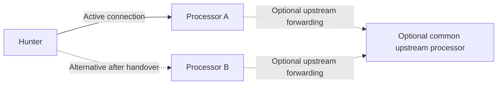

# Hunter processor failover and handover

**Date:** 2026-10-15

**Status:** Research basis; partial implementation and stop conditions are recorded in the linked plan

**Implementation plan:** [Hunter processor failover](../plans/hunter-processor-failover.md)

**Source snapshot:** `7497d44ac842937ea319050f1eec8916443a3d44`

## Purpose and conclusion

Hunters should accept an ordered list of processor endpoints, connect to one at a
time, and try another when initial connection or reconnection fails. This is a
general transport capability for ordinary packet capture, protocol analysis,
monitoring, PCAP collection, and supported normalized-event workflows. It must work
in non-LI builds without ADMF, MDF, or interception-specific configuration.

Candidates may be independent processors, or intermediate processors forwarding
to a common upstream processor. A common upstream is useful for retaining a single
analysis point, but is not required for endpoint failover. Redundant direct
endpoints and hierarchical relay deployments are both supported models. LI is
an optional application, with additional authorization and
delivery requirements described separately below.

This is a good fit for hunter-side endpoint selection and the project's existing
hierarchical architecture. A common central processor reduces the need to move
TCP and VoIP analysis state between relay processors. However, source inspection
found that the existing packet transport is not sufficient to promise reliable
hunter store-and-forward operation. In particular:

- The hunter supports one processor address and retries that address indefinitely.
- The raw upstream relay implementation and central packet-stream admission checks
  have an apparent contract mismatch that must be resolved and tested.
- Packet disk overflow is ephemeral; it is not an acknowledgment-backed,
  crash-recoverable spool and is not continuously populated during disconnection.
- A relay packet ACK does not establish durable receipt at the central
  processor. Several current forwarding paths can drop accepted traffic.
- Processor filter stores are local; equivalent policies across candidate
  processors require explicit management or synchronization.

An ordered list can be delivered as a bounded connectivity feature. Reliable
intermittent-link operation additionally needs explicit packet custody, stable
source/session identities, filter synchronization, and delayed-data semantics.
These are separate changes; no lossless or exactly-once guarantee follows from
endpoint failover alone.

The findings apply at different levels; they must not all become prerequisites
for the core feature:

| Capability                                                                      | Applicability                                                                                        |
| ------------------------------------------------------------------------------- | ---------------------------------------------------------------------------------------------------- |
| Ordered candidates, bounded attempts, coordinated reconnection, endpoint status | General hunter failover, with independent or hierarchical processors                                 |
| Relay ingress, origin delegation, common-upstream readiness                     | Hierarchical deployments only                                                                        |
| Durable storage, custody receipts, replay and deduplication                     | Deployments requiring stronger delivery guarantees; not implied by a processor list                  |
| Shared filter reconciliation                                                    | Deployments requiring common policy across candidates; independent policy may instead be intentional |
| Task generations, offline interception leases, ADMF/MDF delivery rules          | Optional LI specialization only                                                                      |

## Deployment model and requirements established by the discussion

The user-established scope is an ordered processor list, initial connection
fallback, and switching to another processor when reconnection to the current
processor fails. The feature is generally applicable; LI is one consumer of it.
A hunter has one active processor at a time; simultaneous duplicate transmission
is not part of the requested feature.

For independent processors, delivery and analysis continue at the newly selected
processor, but its analysis state and output files are independent. Failover does
not replicate processor state. In a hierarchical deployment, candidates are relay
processors that forward to the same central processor. That central endpoint may
be absent from the hunter's candidate list. If the
central processor runs LI, it additionally connects to ADMF/MDF; that choice does
not change the generic endpoint-selection mechanism.

Network outages and server failures can both make a candidate unavailable. A
period without a usable processor should have an explicit operational state.
This document assumes no particular network technology, link latency, throughput,
outage duration, or storage capacity.

Failover should preserve the configured forwarding mode and its negotiated
capabilities. Raw-packet mode is appropriate when downstream consumers need packet
content, central packet analysis, or PCAP output. Normalized-event mode is valid
for supported event-based workflows, but omits original packet content and is not
a substitute for reliable raw-packet forwarding. Never silently change mode or
strand pending data to make another candidate connect. Existing event policy
boundaries can require draining and rotating a producer session when filters
change; endpoint selection must respect those existing contracts.

## Research method and evidence

This report is based on read-only inspection of the Go implementation at the
snapshot above and the official gRPC documentation linked below. Existing tests
were inspected where relevant, but no new runtime reproduction, hardware exercise,
network simulation, or test run was performed for this documentation task.
Implementation findings are distinguished from proposed changes. Historical
research and architecture comments are not treated as proof of current behavior.

| Area                                                        | Current source evidence                                                                                                                                                                                                                                                                                     |
| ----------------------------------------------------------- | ----------------------------------------------------------------------------------------------------------------------------------------------------------------------------------------------------------------------------------------------------------------------------------------------------------- |
| Single endpoint and configuration                           | [hunt.go](../../cmd/hunt/hunt.go), `--processor`; [config.go](../../cmd/hunt/config.go), `buildHunterConfig`; [hunter.go](../../internal/pkg/hunter/hunter.go), `Config` and `Start`                                                                                                                        |
| Connection lifecycle, retries, registration, cleanup        | [connection/manager.go](../../internal/pkg/hunter/connection/manager.go), `connectionManager`, `connectToProcessor`, `register`, `cleanup`                                                                                                                                                                  |
| Capture queues and overflow                                 | [capture.go](../../internal/pkg/capture/capture.go), `PacketBuffer` and live enqueue; [packet_buffer_config.go](../../internal/pkg/capture/packet_buffer_config.go)                                                                                                                                         |
| Packet batch queue, sending, sequence numbers, ACK handling | [forwarding/manager.go](../../internal/pkg/hunter/forwarding/manager.go), `New`, `ForwardPackets`, `SendBatch`, `HandleFlowControl`, sender loop                                                                                                                                                            |
| Ephemeral packet disk overflow                              | [disk_buffer.go](../../internal/pkg/hunter/buffer/disk_buffer.go), `New`, `Read`, `Close`                                                                                                                                                                                                                   |
| Raw packet wire contract                                    | [data.proto](../../api/proto/data.proto), `PacketBatch`, `CapturedPacket`, `StreamControl`                                                                                                                                                                                                                  |
| Central packet admission and ACK                            | [processor_grpc_handlers.go](../../internal/pkg/processor/processor_grpc_handlers.go), `StreamPackets`, `RegisterProcessor`; [hunter/manager.go](../../internal/pkg/processor/hunter/manager.go), `AdmitPacketStream`                                                                                       |
| Relay forwarding and flow control                           | [upstream/manager.go](../../internal/pkg/processor/upstream/manager.go), registration, `Forward`, sender and ACK receiver; [flow/controller.go](../../internal/pkg/processor/flow/controller.go), `Determine`                                                                                               |
| Packet conversion and origin identity                       | [grpcadapter/adapter.go](../../internal/pkg/pipeline/grpcadapter/adapter.go); [processor_packet_pipeline.go](../../internal/pkg/processor/processor_packet_pipeline.go), `processBatch`                                                                                                                     |
| Central event/analysis scope                                | [protocol_events.go](../../internal/pkg/processor/protocol_events.go); [tcp_reassembly.go](../../internal/pkg/eventanalysis/tcp_reassembly.go); [runtime.go](../../internal/pkg/eventanalysis/runtime.go)                                                                                                   |
| Filter snapshots and matching                               | [hunter filtering/manager.go](../../internal/pkg/hunter/filtering/manager.go); [capture/manager.go](../../internal/pkg/hunter/capture/manager.go); [application_filter.go](../../internal/pkg/hunter/application_filter.go); [management.proto](../../api/proto/management.proto), `Filter`, `FilterUpdate` |
| LI filter integration and task admission                    | [processor_li.go](../../internal/pkg/processor/processor_li.go), `processorFilterPusher`; [processor filtering/manager.go](../../internal/pkg/processor/filtering/manager.go); [LI manager.go](../../internal/pkg/li/manager.go)                                                                            |
| Delayed LI provenance and replay bounds                     | [LI filters.go](../../internal/pkg/li/filters.go); [processor_li_persistent.go](../../internal/pkg/processor/processor_li_persistent.go); [delivery/client.go](../../internal/pkg/li/delivery/client.go); [processor_radius_li.go](../../internal/pkg/processor/processor_radius_li.go)                     |
| Existing durable event transport                            | [eventforwarding/client.go](../../internal/pkg/hunter/eventforwarding/client.go); [eventspool/spool.go](../../internal/pkg/hunter/eventspool/spool.go); [event_ingress.go](../../internal/pkg/processor/event_ingress.go)                                                                                   |
| TLS key attachment                                          | [tls_key_forwarder.go](../../internal/pkg/hunter/tls_key_forwarder.go), `AttachKeys`                                                                                                                                                                                                                        |

## Findings and proposed solutions

### 1. Ordered endpoint selection belongs in the connection manager

**Current behavior:** `hunter.processor_addr` and `--processor` are scalar values.
The connection manager retries the same address, with exponential backoff capped
at 60 seconds and one circuit breaker. `Hunter.Start` configures unlimited retry
attempts. Registration uses the hunter lifetime context, without an overall
endpoint-attempt deadline. The TCP dial timeout alone does not bound the complete
connect, TLS, registration, and stream-readiness operation.

**Proposed solution:** Keep the current address syntax compatible and normalize
old and new configuration into an ordered endpoint list. A new list key such as
`hunter.processors` is a proposal, not an existing option. Define precedence if
both scalar and list forms are supplied; rejecting ambiguous combinations is
preferable to silently concatenating different policies. Validate empty entries,
duplicates, endpoint syntax, and per-endpoint transport settings.

At startup, try candidates in order. After an established connection fails,
allow a bounded reconnect opportunity to that relay, then advance through the
list and wrap around. Use per-endpoint retry/circuit-breaker state and jittered
backoff after an unsuccessful sweep. A dead relay must not impose its backoff on
an untried healthy alternative. Keep the successful relay active until it fails;
automatic return to the first relay is optional future policy.

Define an attempt context covering readiness and registration. Preserve the
separate long-lived connection context after success so the attempt deadline does
not terminate a healthy stream later. Treat successful client construction as
insufficient evidence of a usable processor. Authentication, incompatible protocol,
and stale-policy failures should have distinct diagnostics and should never cause
a silent security downgrade.

The official [gRPC deadline guide](https://grpc.io/docs/guides/deadlines/) explains
that RPCs have no deadline by default. Timeout values must come from the deployment
requirements and measurements, rather than an invented deployment-wide target.

### 2. Existing raw relay admission needs an explicit protocol contract

**Current behavior:** An upstream manager registers the relay processor with
`RegisterProcessor`, then uses one upstream packet stream. Forwarded batches retain
their original hunter IDs. Central `StreamPackets`, however, requires a current
packet-mode **hunter** registration for the first batch and pins the stream to
that hunter ID. `RegisterProcessor` registers a downstream processor, not each
origin hunter. A second hunter ID on the same stream is rejected.

This is an apparent integration gap in the inspected source, even before adding
hunter handover. Existing hierarchical forwarding machinery must not be
described as proof that the desired multi-hunter raw route currently works.
The conclusion is based on source inspection, not a new end-to-end reproduction.

**Proposed solution:** Define authenticated relay admission explicitly. A relay
stream needs a registered relay identity plus authorized origin identities and
origin session contracts. Either introduce a dedicated multiplexed relay packet
service, or use separate origin streams with explicit delegated registration.
The former matches the existing shared upstream sender; the latter requires
stream management per origin. Decide the wire contract before implementing it.

Preserve the strict direct-hunter admission checks. Do not fix this by accepting
arbitrary `hunter_id` strings, automatically impersonating hunters through ordinary
registration, or assigning every relayed packet the relay processor's ID. Capability
negotiation must reject older peers that cannot enforce the selected relay model.

### 3. Disconnected capture is not durable matched-packet collection

**Current behavior:** Capture starts before initial registration. In packet mode,
the forwarding generation both consumes captured packets and performs batching
and filtering. During disconnection that generation exits, while capture continues
into bounded capture queues. There is no independent packet batcher writing newly
captured traffic to disk throughout the outage. Full capture queues drop traffic.
The hunter-owned memory batch queue survives reconnects, but this preserves only
batches still in that queue.

**Proposed solution:** For store-and-forward operation, separate the hunter-lifetime
capture/filter/batch/spool pipeline from the connection-lifetime sender. The
offline producer must continue applying valid policy and appending eligible raw
packets independently of relay reachability. Enforce configured byte,
age, memory, and exhaustion limits, with explicit loss accounting and recovery.

Before first contact or after restart, define which capture/filter policy applies:
locally configured capture, a deliberately unfiltered general capture, an allowed
cached remote snapshot, or waiting for remote policy. General capture does not
universally require a remote authorization lease. Deployments that require remote
authority must deny affected collection when that authority is unavailable or
invalid. `no-filter-policy=deny` at application matching is not proof that
pre-registration capture never stores unrelated packet content. Current initial
BPF policy application discards prepolicy capture-buffer contents; the new design
must define this boundary deliberately.

### 4. Packet overflow storage must not be mistaken for a durable spool

**Current behavior:** A new packet forwarding manager is created on each successful
connection. Its disk buffer constructor deletes old `batch-*.pb` files. `Read`
removes a disk record before transport delivery, and `Close` removes remaining
records. A send failure drops the pending batch instead of retaining it for an
acknowledged replay. Reconnection therefore does not preserve this disk backlog.

**Proposed solution:** A reliable raw-packet profile needs recoverable append and
commit records, immutable batch identities, bounded storage, integrity checks,
explicit retirement after the selected ACK, and crash-safe recovery. Spool
ownership must outlive connection generations. Sensitive packet content and
attached TLS secrets require an explicit at-rest protection and key-management
policy. Preserve expiry, configured limits, and accounting when recovering data.

The existing event spool offers design patterns: persist before send, replay with
the original identity, and retire through cumulative acknowledgment. Its event
schemas and guarantees do not automatically apply to raw packets. Reuse suitable
storage primitives only after defining the raw-packet contract.

### 5. Choose where packet custody transfers

**Current behavior:** A processor ACK follows `processBatch` and flow-control
calculation. Upstream forwarding is an asynchronous, void-returning queue operation.
It can drop when disconnected or full; send failures and generation teardown can
also discard queued traffic. The upstream ACK receiver does not commit retained
packet records. The hunter logs packet ACK sequences but does not maintain an
ACK-retired retransmission window. A successful gRPC `Send` is not durable central
acceptance and is not completion of downstream output or analysis.

Two useful future contracts have different costs:

| Contract                | When the hunter may retire its copy                                                      | Consequence if a relay processor is lost                                                                                                        |
| ----------------------- | ---------------------------------------------------------------------------------------- | ----------------------------------------------------------------------------------------------------------------------------------------------- |
| Durable relay custody   | The relay durably commits the batch and accepts responsibility for upstream retry        | Traffic held only by the lost relay is unavailable until its storage is recovered; permanent relay loss can lose the sole remaining copy        |
| Durable central receipt | An authenticated receipt identifies durable acceptance by the intended central processor | Unconfirmed batches remain on the hunter and can be replayed through another relay; hunter storage and acknowledgment routing must support this |

For resilience to loss of a relay after local acceptance, **central receipt is
the stronger design candidate**, not a user-approved requirement. A relay can
provide a separate local receipt without authorizing deletion of the hunter's
copy. Receipt identity must include the intended central destination or deployment
domain, origin, producer session, and sequence coverage; a relay must not be able
to substitute a local ACK for a central receipt. Receipt updates must remain
available through the new path after handover, including querying already committed
coverage when the old path carried the batch but lost its return receipt.

Durable central ingestion requires atomic or recoverably consistent recording of
accepted batches and deduplication state before acknowledgment. It does not by
itself make downstream analysis or output side effects exactly once. Consumer
delivery and authorization boundaries remain separate; LI adds its own checks.

### 6. Stable origin identity, deduplication, and ordering are required

**Current behavior:** Raw `PacketBatch` carries hunter ID, sequence, and timestamp,
but no general producer-session identifier. Packet sequence state belongs to a
newly constructed forwarding manager and restarts on reconnect, while older
queued batches may remain. These fields cannot safely identify a globally unique
batch across reconnects and reboots. Adapters preserve origin hunter IDs and
capture timestamps, which is a useful starting point.

**Proposed solution:** Introduce an immutable identity such as
`(origin_node_id, producer_session_id, batch_sequence)` and retain it through every
relay. A producer session represents a defined capture/policy lifetime, not a TCP
connection or current relay processor. Ordinary handover must not reset it. A real
restart or policy boundary must have explicit recovery or rotation semantics.
Retain capture source, interface, observation domain, and applicable provenance.

Deduplication at the selected ingestion boundary must occur before
duplicate-sensitive analysis and output. Compare content identity for repeated batch IDs; reject conflicting
reuse rather than merging unrelated packets. Recover deduplication state
consistently with durable receipts. Bound retained deduplication history and define
which producer sessions/replay windows remain acceptable after history expires.

Old relay A may forward a backlog after newer traffic arrives through B. A
cumulative ACK must never cross an unknown sequence hole; represent missing or
discarded ranges explicitly, or use selective receipts. Reorder within configured
bounds and expose gaps and late arrivals when those bounds are exceeded. Existing
priority capture lanes already mean there is no strict universal capture order;
specify batch delivery order separately from original packet timestamps.

### 7. Central analysis continuity is conditional

**Current behavior:** Central protocol analysis uses source identity rather than
simply the relay address. TCP observation scope includes origin node, capture
epoch, capture source, and interface. Central live analysis also expires idle
state. Relays run their own processing pipeline and can enrich metadata; sharing
one central processor alone does not prove uninterrupted canonical reassembly or
call state across every handover.

**Proposed solution:** Keep observation identity stable across route changes and
keep central analysis authoritative. Test fresh and delayed raw packets arriving
through different relays, including conflicting relay metadata. Preserve the
separation between direct packet filter matches and inherited call identity.
Do not merge distinct hunters just because they observe identical addresses.

Define a late/backfill policy for data arriving after connection or call expiry:
record a gap, process as explicitly late data, or use a separate bounded offline
analysis path where appropriate. Do not disable idle expiry or bypass configured
resource limits merely to conceal a contact gap. Consumer-specific finalization
and authorization rules still apply, including the LI rules described below.
Continuous state through an arbitrarily long blackout is not a supported promise.

### 8. Filter policy across candidates must be explicit

**Current behavior:** Each processor has a local managed filter store.
Ordinary subscriptions distribute that store to directly
connected hunters. Hierarchical management offers targeted proxy operations,
but an upstream relationship alone is not automatic replication of all central
filters to every candidate relay. An idle backup may never have hosted a given
hunter before it is selected.

**Proposed solution:** Define whether candidate processors intentionally have
independent policies or share one desired policy. Ordinary failover can use each
processor's authoritative policy, provided changes are explicit and existing
producer/session boundaries are respected. Equivalent capture across candidates
requires management of equivalent snapshots, either operationally or through
explicit synchronization; a common upstream alone does not provide it.

For a centrally managed hierarchy, make the policy owner and deployment domain
explicit. Reconcile versioned filter snapshots to every eligible relay, including
deletions, applicable revisions, and target-hunter restrictions. A relay needs a
full applicable snapshot before advertising shared-policy readiness. Incremental
updates require snapshot/version recovery
after gaps; a policy hash alone cannot authenticate an otherwise untrusted policy.

On handover, install the new authoritative snapshot atomically before eligible
new forwarding. Define what happens to already batched traffic from the previous
policy; it is not automatically re-filtered today. Stale relays must not silently
restore deleted filters. Tests must distinguish an authoritative empty
policy from failed synchronization and must cover a relay with no prior hunter
topology entry.

### 9. Connection health is not route readiness

**Current behavior:** A hunter can reach a relay whose upstream is disconnected.
The raw upstream queue can report depth zero without a live generation while
`Forward` drops traffic. Existing flow control therefore does not establish a
usable path or durable custody. HTTP/2 keepalive also tests a connection rather
than the full service path; see the official
[gRPC keepalive guide](https://grpc.io/docs/guides/keepalive/).

**Proposed solution:** Report relay connectivity, central route reachability,
policy readiness, custody mode, spool capacity/age, and central receipt progress
as separate facts. A relay with a healthy durable spool but an unavailable
upstream can still be useful under a chosen custody policy; a relay silently
discarding packets cannot. Define selection policy accordingly.

Do not make ordinary load-related SLOW/PAUSE signals automatically trigger a
relay switch, which can amplify central overload across all routes. Detect a
stalled stream using bounded acknowledgment/readiness progress where appropriate,
with settings compatible with measured links and both gRPC peers. Underlying
stream retries do not provide application custody; see the official
[gRPC retry guide](https://grpc.io/docs/guides/retry/).

### 10. Transport security, capture exclusions, and auxiliary metadata must follow the route

**Current behavior:** Data and management use the same selected processor address,
and connection cleanup has generation protection against stale callbacks. TLS
configuration is shared rather than a processor-list abstraction. Automatic
capture exclusion considers the configured processor port. `TLSKeyForwarder`
marks secrets as forwarded when first attaching them, before any durable central
receipt. The schema and central pipeline support transported TLS keys, but source
search found no production construction/attachment callers of that helper; this
does not establish a working hunter key-replay path.

**Proposed solution:** Switch data, management, filter subscription, heartbeat,
and flow-control state as one connection generation. Retain teardown isolation so
an old stream cannot disconnect the replacement or apply stale policy/control.
Reset stale PAUSE state according to the new connection contract. Permit only
trusted candidate relays, validate each endpoint's certificate identity, and
preserve mTLS and source-delegation checks through the hierarchy. Different server
names or trust domains need explicit configuration; disabling verification is
not a handover mechanism.

Review self-traffic exclusions for all candidate data/control endpoints and ports,
including endpoints resolved dynamically, to avoid recapturing forwarded traffic.
Do not broaden exclusions in a way that silently suppresses intended monitored
traffic. If TLS decryption is enabled, couple key availability to retained packet
or acknowledged key records so a lost first key-bearing batch does not make later
traffic undecryptable. Keep key protection and packet provenance intact.

### 11. Upstream and downstream consumer availability remain separate concerns

In the shared-upstream topology, all relays converge on one central processor.
That provides a common analysis point but also leaves a shared availability
dependency. Hunter failover cannot repair an outage shared by every candidate
route or a downstream output failure. Bounded custody queues can bridge outages
only within their configured limits. Independent processors have separate output
and analysis state; a functioning alternative does not recover the failed
processor's files or state automatically. Central replication, alternate upstream
destinations, and consumer-specific availability are separate designs, not
implicit additions to the requested hunter list.

## Optional LI specialization

The following requirements apply when this generic transport carries LI traffic.
They do not introduce ADMF/MDF dependencies or mandatory interception leases into
ordinary capture, monitoring, or event forwarding. The central LI processor remains
the task and delivery authority; the transport must carry the provenance its
consumer needs without interpreting X1 tasks in the generic connection manager.

### LI filter authority, offline interception, and delayed delivery

The central LI filter pusher updates the central processor's local store; it does
not itself replicate LI filters to every candidate relay. Shared policy management
described above must additionally preserve task activation generations, deletions,
expiry, and target restrictions for LI. Relay processors must not enable
LI locally merely to implement endpoint failover.

**Current behavior:** Ordinary `Filter` has a revision but no general validity
deadline or offline lease. Hunter remote filters are held in memory. Disconnect
does not clear previously installed capture/application filters, so a hunter
cannot learn a revocation during loss of contact. Some specialized RADIUS criteria
carry task-generation provenance, but this is not a general offline authorization
contract. Central LI admission already checks task activity, expiry, and generation.

**Proposed solution:** If interception is to continue offline, define a centrally
issued, authenticated policy with validity interval, revision/generation, authorized
source scope, and a bounded disconnected lifetime. Enforce expiry locally across
capture, matching, buffered state, and recovery as applicable. Persisted policy
must not gain a fresh validity period merely because a hunter rebooted. Account
for clock uncertainty and clock rollback; when validity cannot be established,
use the defined deny behavior.

Immediate revocation cannot be learned through a completely absent control path.
An offline lease bounds that uncertainty; it does not eliminate it. Its duration
and permitted disconnected behavior need deployment policy, not an agent-selected
default. Before adding this contract, retain existing authorization checks and do
not characterize continued use of stale filters as verified offline authorization.

Capture eligibility, storage retention, and delivery eligibility are distinct.
A packet captured while a task was active might arrive after deactivation. The
current central admission must not be bypassed using a capture timestamp or old
filter ID. Supporting historical delivery after expiry would require an explicit
authorized model with immutable provenance and task-generation validation. Keep
current rejection behavior until that separate model is defined and approved.

There is also a generation ambiguity in the current raw packet contract: ordinary
matched filter fields contain string IDs, and ordinary LI filter IDs can remain
the same across task changes without a transported activation generation. Delayed
old packets can therefore be associated with a newer task state unless origin
authority is carried explicitly. Extend the capture-authority envelope with the
central authority incarnation, task activation generation, filter revision, and
validity interval, and validate those claims at central ingress and LI admission.
Do not infer historical authority from the current meaning of a reused filter ID.

Transport retention age is also separate from LI delivery age. The existing X3
maximum-age clock begins at central local admission, not the remote capture
timestamp. Hunter and relay spool limits must independently bound
pre-admission retention; do not repurpose capture time to extend central delivery
lifetimes or bypass persistent replay checks on task/destination generations.

### RADIUS source trust and call attribution

RADIUS LI has an additional existing restriction: central source trust requires
the verified immediate peer certificate identity to match the original hunter ID.
A relay processor's certificate does not meet that origin check merely because it
has forwarded a batch. If RADIUS is required, explicitly authorize trusted
relay-to-origin delegation or authenticated end-to-end origin claims; retain the
current untrusted-origin suppression until that contract is implemented.

Preserve direct packet filter evidence separately from inherited call identity.
Handover must not merge competing RTP call ownership, resurrect finalized LI call
generations, or broaden authorization. These checks belong at the existing LI
boundary and remain applicable regardless of the selected processor route.

## Recommended handover state model

| State                          | Meaning and transition                                                                                                                  |
| ------------------------------ | --------------------------------------------------------------------------------------------------------------------------------------- |
| Seeking processor              | Probe the ordered candidates with bounded attempts; local capture and retention follow the configured policy                            |
| Registering and synchronizing  | Authenticate the processor, negotiate the configured mode and applicable capabilities, and apply its authoritative filter snapshot      |
| Active                         | Send through one processor and monitor data/control readiness and acknowledgment progress                                               |
| Reconnecting current processor | Try the current processor within the configured reconnect budget                                                                        |
| Advancing to next processor    | Tear down the old generation and select the next eligible candidate without resetting capture identity solely because the route changed |
| No usable processor            | Continue or suspend bounded capture according to local/remote policy; account for loss and retry candidates with backoff                |

Policy validity is a separate condition, rather than a universal connection state.
A deployment requiring remote authority must stop affected collection when that
authority expires or becomes invalid. Ordinary locally configured capture need
not wait for an interception lease. Shared-upstream readiness is likewise an
additional condition only for deployments that use an upstream path.

Keep any future make-before-break behavior distinct from this single-active-route
model, because it changes duplicate delivery and control ownership.

## Suggested scope and next work

These are proposed work items, not completed implementation or performance gates.
No latency, throughput, outage-retention, CPU, or memory acceptance target has been
established by this discussion.

- [ ] Define the backward-compatible processor-list configuration, selection
      policy, connection-attempt deadlines, and operator-visible active endpoint.
- [ ] Implement and test ordered connection handover independently of stronger
      delivery claims, in non-LI builds and for both supported forwarding modes.
      Preserve existing event replay and policy/session boundaries.
- [ ] Define filter policy transitions across independent candidates and optionally
      shared desired policy, including authoritative empty/deleted snapshots.
- [ ] For hierarchical deployments, reproduce and resolve raw relay admission with
      authenticated origin/session delegation, including multiple hunters and
      handover between two relays. Do not make this a prerequisite for direct
      failover between independent processors.
- [ ] For a reliable raw-packet profile, choose custody and acknowledgment scope,
      then define the raw-packet
      session/sequence and receipt protocol with negotiated compatibility.
- [ ] For that reliable profile, implement lifetime-independent raw spooling, recovery, bounded replay,
      deduplication, and explicit loss/late-data handling for the chosen custody model.
- [ ] Add route/policy readiness, capture exclusion coverage, auxiliary metadata
      reliability, and end-to-end observability where those capabilities apply.
- [ ] For LI deployments, define generation-aware filter synchronization, offline
      authority, and delayed-delivery handling while preserving existing LI gates.
- [ ] Update operator documentation and every configured manual translation when
      implementation changes the documented user interface or behavior.

The endpoint-selection change is useful without a common upstream, durable packet
profile, or LI integration. Each deployment's claims should identify exactly which
additional contracts have been implemented and verified. LI-specific work must
not become a requirement to use generic processor failover.

## Validation scenarios for a later implementation

- [ ] Initial relay refuses connections, silently drops connection traffic, or
      stalls registration; the hunter eventually tries the next candidate.
- [ ] A running stream breaks, or control/data readiness is lost independently;
      all connection-dependent state moves to the selected replacement generation.
- [ ] All candidates are unreachable, then one returns; retries remain cancellable
      and configured capture/spool limits and applicable policy rules remain enforced.
- [ ] A healthy backup remains active when a preferred relay returns; no
      unrequested automatic failback occurs.
- [ ] One relay carries several origin hunters; admission preserves and authorizes
      each origin without accepting spoofed IDs or invalid observation provenance.
- [ ] A relay fails before durable receipt, after receipt but before upstream
      forwarding, and after central acceptance but before its receipt reaches the
      hunter. Recovery follows the selected custody model in each case.
- [ ] A and B deliver overlapping, delayed, and reordered copies; one immutable
      batch identity cannot cause duplicate canonical analysis or skip sequence holes.
- [ ] Hunter, relay, and central processes restart at append/commit boundaries;
      recovery retains the stated custody guarantees and rejects conflicting replay.
- [ ] Generic capture runs in a non-LI build without ADMF/MDF or an upstream
      processor; failover still works with independent candidate processors.
- [ ] Packet and event modes both switch candidates while preserving negotiated
      capabilities, pending data, and existing producer-session boundaries.
- [ ] Candidate policies differ intentionally, or a shared policy changes while
      one candidate is disconnected. New snapshots and removals apply correctly.
- [ ] A hunter starts with local policy, a permitted cached remote policy, or no
      required remote policy; behavior matches its configured no-filter contract.
- [ ] A VoIP call/TCP flow spans handover and a longer blackout. Identity continuity,
      late-data treatment and expiry remain correct within the documented analysis
      contract. Independent processors are not expected to share analysis state.
- [ ] Optional TLS keys arrive on a lost or replayed batch; central decryption
      follows the selected key-retention contract without weakening secret protection.
- [ ] Central or another downstream consumer becomes unavailable while a relay remains reachable;
      status and bounded retention accurately reflect the unavailable downstream path.

Additional LI validation applies only to that specialization:

- [ ] LI filters are deleted, expired, modified, or reactivated while a relay is
      disconnected; stale policy cannot restore an obsolete task generation.
- [ ] A hunter starts without required LI authority, restarts with expired authority,
      experiences clock rollback, or receives an authoritative empty LI snapshot.
- [ ] Delayed and duplicate packets preserve task generations, current LI admission,
      finalized call boundaries, and applicable RADIUS origin-trust checks.
- [ ] Central LI or MDF becomes unavailable; transport custody does not misrepresent
      MDF delivery or bypass deactivation and expiry.

## Deployment inputs still needed before implementation choices are finalized

No further information is necessary to record this research. The following inputs
would affect concrete defaults and the strength of the delivery contract:

| Input                                                                                     | Why it matters                                                                                                                      |
| ----------------------------------------------------------------------------------------- | ----------------------------------------------------------------------------------------------------------------------------------- |
| Acceptable loss and relay-loss scenarios                                                  | Selects best-effort handover, durable relay custody, or central-receipt retention                                                   |
| Connectivity gaps, simultaneous relay reachability, and usable link capacity              | Informs attempt budgets, retry policy, backlog drain behavior, and whether an ordered list is sufficient                            |
| Matched-traffic volume and hunter/relay storage budgets                                   | Sizes bounded retention; no finite spool guarantees arbitrary outage coverage                                                       |
| Shared versus independent candidate filter policy                                         | Determines whether to reconcile common snapshots or explicitly transition between different policies                                |
| Required treatment of late packets after analysis-state expiry                            | Determines late-data processing, archiving, and gap reporting                                                                       |
| Offline interception permission, revocation tolerance, and time-source behavior (LI only) | Determines additional LI validity, expiry, recovery, and clock-uncertainty rules                                                    |
| Relay trust domain, certificate identities, and central deployment identity               | Determines endpoint credentials, relay delegation, and authenticated receipt routing                                                |
| Required forwarding mode, protocols, outputs, and optional decryption                     | Determines analysis continuity cases, compatibility, and auxiliary metadata obligations; LI profiles matter only when LI is enabled |
| Requirement to survive hunter, relay, or central restart                                  | Determines durable recovery and deduplication boundaries                                                                            |

These are deployment decisions to resolve, not reasons to block the research or
invent numerical acceptance gates. The immediate architectural conclusion is
clear: an ordered processor list is a general connectivity feature. Hierarchical deployments expose additional forwarding and intermittent-link
delivery questions. LI adds consumer-specific authority and delivery rules on top of that
general design.

## Implementation findings — 2026-10-17

The implementation on `feat/processor-failover` now provides ordered sticky
selection for hunters and applicable tap/processor upstreams. It also provides
explicitly delegated mTLS raw relay ingress, signed full shared-policy snapshots,
recoverable origin raw spools, and pinned signed terminal-receiver or central
custody receipts. Capture production survives connection replacement and source
restart; central ingestion deduplicates immutable identities before analysis.
See [the operator guide](../PROCESSOR_FAILOVER.md) and
[verified plan status](../plans/hunter-processor-failover.md).

Receiver receipts acknowledge durable ingestion, not completion of every output.
Dispatch can repeat after a crash before its completion checkpoint. Relay custody
with independent retained upstream retry is not offered: forwarding deployments
must use end-to-end central receipt scope. Finite stores cannot cover an arbitrary
blackout or unlimited producer history. Independent processors retain independent
analysis and deduplication state.

The optional LI specialization binds signed finite capture authority to central
incarnation, task activation/filter generation, source scope, and validity. Offline
capture is explicitly configurable; expiry, reboot recovery, rollback, and source
withdrawal do not renew authority. Current LI-owned hunter capture is restricted
to synchronous raw filtering with encrypted independent policy/packet storage;
VoIP/custom buffering is rejected pending a compatible authorization boundary.

The existing HTTP keylog/decryptor helpers do not form a production matched-session
key attachment path. Reliable HTTP keylog configurations therefore fail clearly.
Supporting auxiliary keys requires completing that attachment provider and keeping
keys with the retained immutable batch until authenticated custody. It is separate
from forwarding encrypted TLS payload bytes, which is supported.

Remaining validation work includes full TCP/VoIP blackout semantics and additional
composed crash/LI outage scenarios; these are listed unchecked in the plan. Existing
race suites, real local TLS relay/receipt scenarios, LI suites, role builds, vet,
and translated manual checks pass. The broad suite passes with only the previously
identified missing detector-fixture test explicitly excluded; unmodified
`make test` has not passed.
